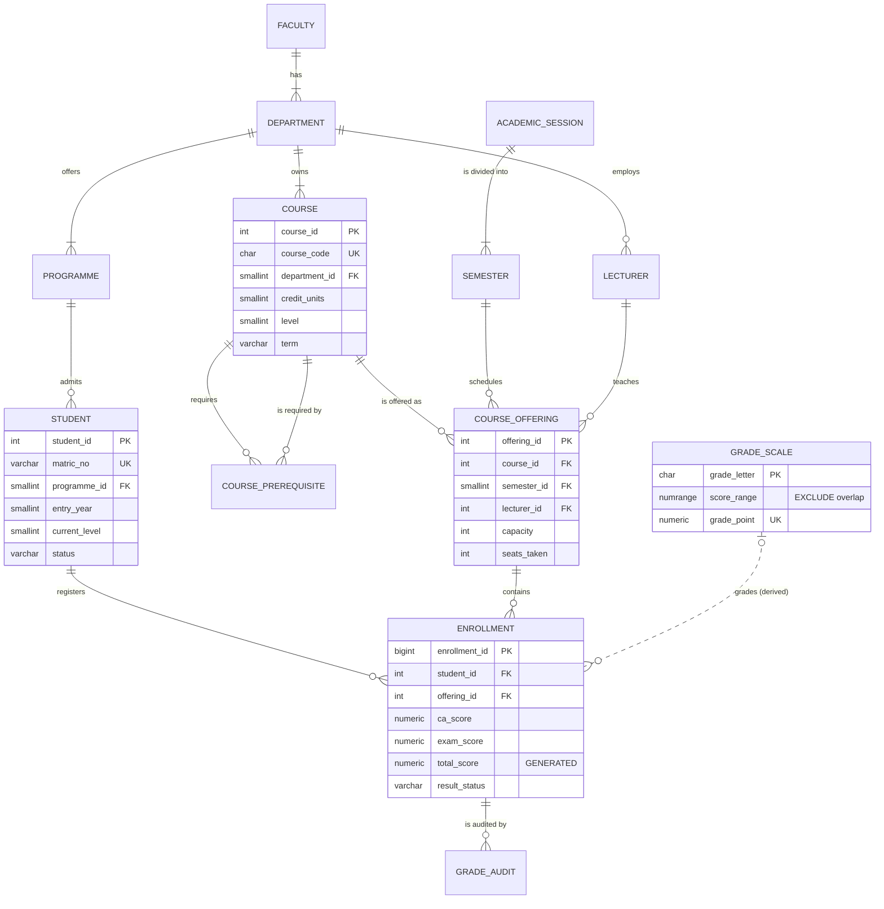

# Portfolio 1 – Database Design and Modelling

**Case study:** Aurelia University Student Result Portal (AUSRP), a simulated university.
**DBMS:** PostgreSQL 18.3

## 1. Case study statement

| Item                              | Description                                                                                                                                                                                                                                                                                                                              |
| --------------------------------- | ---------------------------------------------------------------------------------------------------------------------------------------------------------------------------------------------------------------------------------------------------------------------------------------------------------------------------------------- |
| **Organisation / scenario** | *Aurelia University* is a simulated Nigerian university with 4 faculties, 12 departments and about 20,000 undergraduates. AUSRP is the system of record for course registration and examination results.                                                                                                                               |
| **Nature of the system**    | An OLTP system. Most of the time the load is read-heavy (students checking results, transcripts). At registration time and when results are released, the load becomes write-heavy and concurrent. Results are legal academic records, so integrity and an audit trail are mandatory.                                                    |
| **Users of the database**   | **Students**: register courses, view results/GPA/transcript. **Lecturers**: enter CA and exam scores for courses they teach. **Exams & Records / Registrar**: manage calendar, approve results, produce transcripts and probation lists. **Deans / Senate**: pass-rate reports, dean's list, result corrections. |
| **Major data stored**       | Faculties, departments, programmes, lecturers, students, courses and prerequisites, academic sessions and semesters, course offerings (course × semester × lecturer, with capacity), enrollments with CA/exam scores, the NUC 5-point grading scale, and an audit trail of score changes.                                              |
| **Key operations**          | Register / drop a course (capacity, prerequisite and 24-unit checks). Enter and approve scores. Compute semester GPA and CGPA. Generate a transcript and class of degree. Produce a course broadsheet, pass-rate report, probation list and dean's list.                                                                                 |

The same case study is used in Portfolios 2–5.

## 2. Conceptual model – ER diagram

Source: [diagrams/er_diagram.mmd](diagrams/er_diagram.mmd). GitHub renders the Mermaid diagram below.



(The full attribute list for every entity is in `diagrams/er_diagram.mmd`.)

**Modelling decisions**

* **Student and course is M:N.** The relationship is resolved in two steps. `COURSE_OFFERING` is the course *as taught in one semester by one lecturer*. `ENROLLMENT` is the associative entity between `STUDENT` and `COURSE_OFFERING`. Without the offering entity, the lecturer and capacity would depend on (course, semester) and repeat in every enrollment row.
* **Prerequisites are a recursive M:N** relationship on `COURSE` (`COURSE_PREREQUISITE`). In this model they form a graph, which is used again in Portfolio 4 (`$graphLookup`).
* **Grade is not stored.** `grade_letter` depends on `total_score`, which is a transitive dependency. It is derived by joining `GRADE_SCALE` on range containment (`score_range @> total_score`), shown as a dotted, non-identifying relationship.

## 3. Logical model – relational schema

Underline = primary key, *italic* = foreign key. Full DDL: [sql/01_schema.sql](sql/01_schema.sql). A `pg_dump` of the built schema is in [results/schema_dump.sql](results/schema_dump.sql).

```
FACULTY            (faculty_id, code, name)
DEPARTMENT         (department_id, *faculty_id*, code, name)
PROGRAMME          (programme_id, *department_id*, code, name, award, duration_years)
LECTURER           (lecturer_id, staff_no, *department_id*, title, first_name, last_name, email, academic_rank, hire_date)
STUDENT            (student_id, matric_no, *programme_id*, first_name, last_name, gender, date_of_birth, email,
                    entry_year, current_level, status, created_at)
COURSE             (course_id, course_code, title, *department_id*, credit_units, level, term)
COURSE_PREREQUISITE(*course_id*, *prereq_course_id*)
ACADEMIC_SESSION   (session_id, name, start_date, end_date)
SEMESTER           (semester_id, *session_id*, term, start_date, end_date, registration_open, results_published)
COURSE_OFFERING    (offering_id, *course_id*, *semester_id*, *lecturer_id*, capacity, seats_taken)
GRADE_SCALE        (grade_letter, score_range, grade_point, remark)
ENROLLMENT         (enrollment_id, *student_id*, *offering_id*, registered_at, status, ca_score, exam_score,
                    total_score [generated], result_status, graded_at)
GRADE_AUDIT        (audit_id, *enrollment_id*, old_ca, new_ca, old_exam, new_exam, changed_by, changed_at, reason)
```

## 4. Keys and constraints

| Kind                                                                               | Where                                                                                                                                                                                                                                                         | Why                                                                                                                |
| ---------------------------------------------------------------------------------- | ------------------------------------------------------------------------------------------------------------------------------------------------------------------------------------------------------------------------------------------------------------- | ------------------------------------------------------------------------------------------------------------------ |
| **Surrogate PKs** (`GENERATED ALWAYS AS IDENTITY`)                         | every table                                                                                                                                                                                                                                                   | Stable, compact join keys. Natural keys such as matric numbers can be corrected without cascading updates.         |
| **Natural candidate keys** (`UNIQUE`)                                      | `matric_no`, `staff_no`, `course_code`, `email`, session `name`, `(session_id, term)`, `(course_id, semester_id)`, `(student_id, offering_id)`                                                                                                | Business identity is still enforced: no duplicate student, no double registration.                                 |
| **Composite PK**                                                             | `course_prerequisite(course_id, prereq_course_id)`                                                                                                                                                                                                          | A pure relationship table needs no surrogate key.                                                                  |
| **Foreign keys** `ON DELETE RESTRICT`                                      | all references                                                                                                                                                                                                                                                | A student, course or offering that has results can never be deleted (test T12).                                    |
| **CHECK – domain**                                                          | scores `ca 0–30`, `exam 0–70`. `credit_units 1–6`, `level ∈ {100..600}`, `status`, `gender`, `award`, `term` enumerations                                                                                                                 | Invalid values never reach the table.                                                                              |
| **CHECK – format (regex)**                                                  | `matric_no ~ '^AU/[0-9]{4}/[0-9]{5}$'`, `staff_no`, `course_code`, `email`, session `name`                                                                                                                                                          | Identifiers follow university conventions.                                                                         |
| **CHECK – cross-column**                                                    | course-code digit = level (`CSC3xx` → 300). Session `2025/2026` must be consecutive years. `end_date > start_date`. Student is at least 14 at entry. `COMPLETED ⇒ both scores present`. `APPROVED ⇒ COMPLETED`. `0 ≤ seats_taken ≤ capacity` | Rules that span several columns of one row.                                                                        |
| **EXCLUDE USING gist**                                                       | `grade_scale(score_range WITH &&)`                                                                                                                                                                                                                          | No two grade bands can overlap, so every score maps to exactly one grade (verified: 560,028 results, 0 unmatched). |
| **Generated column**                                                         | `total_score = ca_score + exam_score STORED`                                                                                                                                                                                                                | A derived value that the DBMS keeps correct, so no update anomaly is possible.                                     |
| **Triggers**                                                                 | `enrollment_grade_audit` (AFTER UPDATE) writes `grade_audit`. `enrollment_protect_approved` (BEFORE UPDATE) blocks changes to approved results unless `app.senate_override = on`                                                                      | Audit trail and business rules that constraints cannot express.                                                    |
| **Stored functions**                                                         | `fn_register_course` (capacity, prerequisites, 24-unit limit, row lock), `fn_drop_course`, `fn_semester_gpa`, `fn_cgpa`, `fn_degree_class`. Views `v_result`, `v_transcript`                                                                    | Registration and grading logic lives in one place, inside the transaction.                                         |
| **Roles and row-level security** ([sql/05_security.sql](sql/05_security.sql)) | `uni_registrar`, `uni_lecturer`, `uni_student`. A column-level `GRANT UPDATE (ca_score, exam_score, …)`. RLS policies on `enrollment`                                                                                                              | A lecturer sees only enrollments in offerings they teach. A student sees only their own approved results.          |

## 5. Normalisation

### 5.1 Starting point – the paper "result sheet" (UNF)

Before the portal existed, the Exams Office kept one spreadsheet row per student per semester, with the courses as a repeating group:

| matric_no | student_name | programme | department | faculty | session | term | {course_code, course_title, units, lecturer, ca, exam, total, grade, gp} × 6 |
| --------- | ------------ | --------- | ---------- | ------- | ------- | ---- | ----------------------------------------------------------------------------- |

**Functional dependencies** identified from the university's rules:

```
FD1  matric_no                       → student_name, programme, entry_year, ...
FD2  programme                       → department
FD3  department                      → faculty
FD4  course_code                     → course_title, units, level, term, department
FD5  course_code, session, term      → lecturer            (one lecturer per offering)
FD6  staff_no                        → lecturer_name, department
FD7  matric_no, course_code, session, term → ca, exam
FD8  ca, exam                        → total
FD9  total                           → grade                (NUC scale)
FD10 grade                           → gp
```

Anomalies in this form:

* **Update anomaly:** renaming a course means editing thousands of rows.
* **Insertion anomaly:** a new course cannot be recorded until a student takes it.
* **Deletion anomaly:** deleting the last result of a course loses the course itself.

### 5.2 First normal form (1NF)

The repeating group is removed: one row per (student, course, semester), and every attribute is atomic (student name is split into first/last).
Key: **(matric_no, course_code, session, term)**.

### 5.3 Second normal form (2NF): remove partial dependencies

* FD1 depends only on `matric_no` → **STUDENT**.
* FD4 depends only on `course_code` → **COURSE**.
* FD5 depends only on `(course_code, session, term)` → **COURSE_OFFERING**. Session and term become **ACADEMIC_SESSION / SEMESTER**.
* What is left (ca, exam, …) depends on the whole key → **ENROLLMENT(student, offering, ca, exam, …)**.

### 5.4 Third normal form (3NF): remove transitive dependencies

* `matric_no → programme → department → faculty` (FD2, FD3) → **PROGRAMME, DEPARTMENT, FACULTY**.
* `offering → staff_no → lecturer_name` (FD6) → **LECTURER**.
* `enrollment key → total → grade → gp` (FD9, FD10) → **GRADE_SCALE**. The grade is derived, not stored.
* `total` (FD8) is derived from `ca + exam`. It is kept as a **generated column**. The DBMS computes it, so it cannot become inconsistent. This is a safe exception to "don't store derived data".

### 5.5 Boyce–Codd normal form (BCNF)

Every determinant in every table is a candidate key:

* `COURSE_OFFERING` has two candidate keys, `offering_id` and `(course_id, semester_id)`. Both are enforced (PK + UNIQUE).
* `ENROLLMENT` has two candidate keys, `enrollment_id` and `(student_id, offering_id)`.
* `GRADE_SCALE`: `grade_letter`, `grade_point` and the (non-overlapping) `score_range` each determine the whole row.

The schema is therefore in **BCNF**.

### 5.6 Controlled denormalisation

`course_offering.seats_taken` duplicates `COUNT(enrollment)`. It is kept on purpose because it gives a single row to **lock** when registrations race (Portfolio 3). It is changed only inside `fn_register_course` / `fn_drop_course`, in the same transaction as the enrollment insert/update. Portfolio 3 shows what happens to this counter when an application does *not* follow that rule. Portfolio 2 adds a second deliberate denormalisation (a materialized view of CGPA) and explains when it is refreshed.

## 6. Data set

[sql/03_generate_data.sql](sql/03_generate_data.sql) generates reproducible synthetic data (`setseed(0.8103)`). Names come from Nigerian name pools. Scores come from a per-student "ability" drawn from a normal distribution (Box–Muller), so a student's results are correlated across courses, as they would be in reality.

| table                            |                                                             rows |
| -------------------------------- | ---------------------------------------------------------------: |
| faculty / department / programme |                                                      4 / 12 / 12 |
| lecturer                         |                                                              180 |
| student (cohorts 2021–2026)     |                                                           20,000 |
| course / course_prerequisite     |                                                        576 / 432 |
| academic_session / semester      |                                                           6 / 12 |
| course_offering                  |                                                            3,456 |
| **enrollment**             | **613,360** (560,028 graded, 53,332 current registrations) |

Database size: 109 MB (enrollment table 93 MB). Grade distribution: A 25.9%, B 25.2%, C 24.7%, D 9.2%, E 6.5%, F 8.5%.

## 7. How it was implemented and tested

```bash
./portfolio-1-database-design/run.sh     # drops/creates university_portal, builds and verifies (~15 s)
```

| File                          | Purpose                                                             |
| ----------------------------- | ------------------------------------------------------------------- |
| `sql/01_schema.sql`         | Tables, keys, constraints, FK indexes                               |
| `sql/02_reference_data.sql` | Faculties, departments, programmes, grade scale, sessions/semesters |
| `sql/03_generate_data.sql`  | Lecturers, courses, prerequisites, offerings, students, enrollments |
| `sql/04_logic.sql`          | Views, GPA/CGPA functions, registration function, triggers          |
| `sql/05_security.sql`       | Roles, column privileges, row-level security                        |
| `sql/06_verify.sql`         | Row counts, 16 integrity tests, sample transcript, RLS checks       |

**Evidence** (in [results/](results/)):

* [verification_output.txt](results/verification_output.txt): **16 out of 16 negative tests are rejected by the DBMS** with the expected SQLSTATE: `23514` check, `23P01` exclusion, `23505` unique, `23503` FK, `23001` restrict, `428C9` generated column, `P0001` trigger, `AU002` prerequisite, `42501` privilege.
* Sample transcript with semester GPA and running CGPA (window function), and class of degree.
* RLS: lecturer 1 sees exactly the 3,518 enrollments of the 12 offerings they teach. Student 7 sees only their own 48 rows.
* [enrollment_table_definition.txt](results/enrollment_table_definition.txt): `\d+ enrollment` showing all constraints, triggers and policies.
