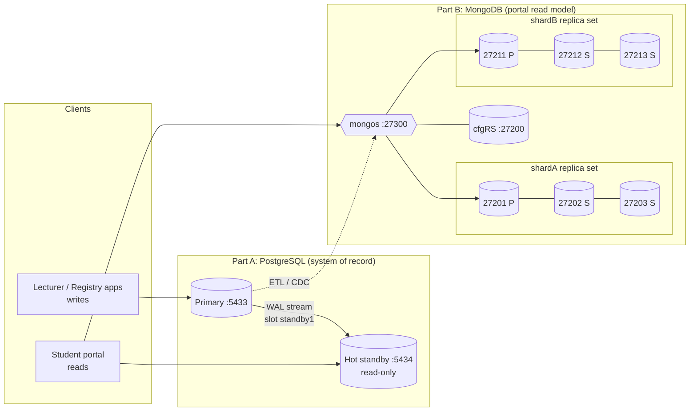

# Portfolio 5 – Distributed and Cloud Database Exercise

**Case study:** AUSRP. The university needs the portal to stay up on result-release day, when all 20,000 students log in within hours. It must also **never lose an approved result**. This portfolio builds and tests two real distributed deployments on one machine and maps them to a cloud design.

| Part | Technology | Concepts demonstrated |
|---|---|---|
| A | PostgreSQL 18 physical streaming replication (primary + hot standby) | replication, replication lag, read scaling, sync vs async (RPO), CAP trade-off, failover/promotion (RTO), pg_rewind |
| B | MongoDB 8.0 sharded cluster: 2 shards × 3-member replica sets + config server + mongos | hash sharding, data distribution, query routing, write/read concern, read preference, distributed transactions, automatic election |
| C | Cloud deployment design | managed services, multi-AZ, backups, cost |

```bash
./portfolio-5-distributed-cloud/run.sh       # builds both clusters, runs all experiments, stops them (~90 s)
KEEP_RUNNING=1 ./portfolio-5-distributed-cloud/run.sh   # leave clusters up for inspection
```

All nodes run on `localhost` (separate data directories under `.data/`, separate ports). The development database on :5432 is only read (`pg_dump`). Because everything is on one host, network latency is near zero. The *mechanisms* are real, but the latency numbers are lower bounds compared with a real multi-host deployment (see Section 4).

## Architecture



---

## Part A – PostgreSQL streaming replication

Setup: [scripts/pg_replication_setup.sh](scripts/pg_replication_setup.sh).
* `initdb` creates the primary. Config ([config/postgresql.primary.conf](config/postgresql.primary.conf)): `wal_level=replica`, `max_wal_senders=10`, `max_replication_slots=10`, `hot_standby=on`.
* The AUSRP database is loaded with `pg_dump | psql`.
* The standby is cloned with `pg_basebackup -R -X stream -C -S standby1`. This creates a **replication slot** and writes `standby.signal` and `primary_conninfo` ([config/postgresql.standby.auto.conf](config/postgresql.standby.auto.conf)).

Experiments: [scripts/pg_replication_demo.py](scripts/pg_replication_demo.py). Output: [results/pg_replication_output.txt](results/pg_replication_output.txt).

| # | Experiment | Result |
|---|---|---|
| R1 | Topology | Primary `in_recovery=false`, standby `true`. Both hold 613,360 enrollments. `pg_stat_replication`: `state=streaming, sync_state=async`. Physical slot `standby1` is active. |
| R2 | **Replication lag** (commit on primary → row visible on standby, 50 probes) | **median 0.19 ms, p95 0.31 ms, max 2.11 ms**. A bulk update of 53,328 rows (658 ms) was replayed **66 ms** after commit. This is the window of **eventual consistency** for reads routed to the replica. |
| R3 | Read-only standby / read scaling | `UPDATE` on the standby: `[25006] cannot execute UPDATE in a read-only transaction`. The transcript query (Q01) runs on the standby: one client sustains about **4,700 transcript reads/s**, which takes that load off the primary. |
| R4 | **Async vs sync commit** (300 single-row commits) | async median 0.134 ms / p95 0.282 ms. Sync (`synchronous_standby_names='FIRST 1 (standby1)'`, `sync_state=sync`): median 0.195 ms / p95 0.456 ms. On one host the extra cost is only a local round trip. Across availability zones it adds one network RTT (about 1–2 ms) to every commit. |
| R5 | **CAP trade-off** | Sync mode with the standby stopped: the `INSERT` is still waiting after 3 s (`wait_event=IPC:SyncRep`). After cancelling, PostgreSQL warns: *"canceling wait for synchronous replication … The transaction has already committed locally, but might not have been replicated to the standby."* Synchronous replication gives up **availability** for **consistency/durability** when the replica is partitioned. Switching back to async restores writes. |
| R6 | **Failover** | `pg_ctl stop -m immediate` on the primary simulates a crash, then `pg_ctl promote` on the standby. The new primary accepts writes **0.24 s** after the crash (RTO, excluding failure detection). The timeline changes **1 → 2**. The last write committed before the crash is present: **RPO = 0** for replicated commits. |
| R7 | **Re-join with pg_rewind** | `pg_rewind: servers diverged at WAL location 0/CF84C30 on timeline 1 … Done!`. The old primary restarts as a standby of the new primary (`application_name=old_primary, state=streaming`), so the roles are swapped without a full re-clone. pg_rewind needs data checksums or `wal_log_hints`; PG18 `initdb` enables checksums by default. |

**Lessons from Part A**
* A problem I hit: `pg_rewind` copies the *source's* configuration files, so the rewound node first tried to start on port 5434 with the wrong `primary_conninfo`. The fix (in the script) is to write a fresh `postgresql.auto.conf` and a dedicated slot `old_primary` after rewinding.
* In production, failure detection and promotion are automated (Patroni with etcd, or a managed service). Detection takes longer than the 0.24 s promote time measured here (usually 10–30 s of health checks). Without fencing there is a risk of **split brain**, where two primaries accept writes.

---

## Part B – MongoDB sharded cluster

Cluster manager: [scripts/mongo_cluster.py](scripts/mongo_cluster.py) (start/stop/status). Replica-set configurations and exact process command lines: [config/](config/). Experiments: [scripts/mongo_sharding_demo.py](scripts/mongo_sharding_demo.py). Output: [results/mongo_sharding_output.txt](results/mongo_sharding_output.txt).

**Shard key choice:** `{_id: "hashed"}`, where `_id` is the matric number.
* **High cardinality** and **uniform distribution**: hashing removes the monotonically increasing pattern of new cohorts (`AU/2026/…`), which would otherwise send all new students to the last chunk (a hot shard).
* **Query isolation**: the dominant portal query is "one student by matric number", which is routed to exactly one shard.
* A **range key on `department.code`** was rejected. It has low cardinality (12 values), so chunks cannot be split. It would also make departments with heavy result-release traffic into hot shards. It would only make sense for *zone sharding*, for example pinning a faculty's data to a region.

| # | Experiment | Result |
|---|---|---|
| S1 | Topology | `cfgRS` (1 node), `shardA` 27201 P / 27202 S / 27203 S, `shardB` 27211 P / 27212 S / 27213 S, and `mongos` (`isdbgrid`) |
| S2 | Load via mongos | 20,000 documents (same validator as Portfolio 4) inserted in 4.4 s |
| S3 | **Distribution** | shardA **9,937 docs (49.7 %)**, 69.7 MB; shardB **10,063 docs (50.3 %)**, 70.4 MB. One chunk per shard covering half of the hash range each. |
| S4 | **Query routing** (`explain`) | by `_id`: `SINGLE_SHARD`, contacts only shardA. By `department.code`: `SHARD_MERGE`, scatter-gather to both shards (870 + 858 docs merged by mongos) |
| S5 | **Write concern** (200 inserts each) | `w:1` median **0.46 ms**; `w:"majority"` **9.97 ms**; `w:"majority", j:true` **9.76 ms**. Majority acknowledgement waits for a secondary to replicate the write. Only these writes are guaranteed to survive a primary failure; a `w:1` write may be **rolled back**. |
| S6 | **Read preference** | `primary` is served by :27201 (PRIMARY); `secondary` is served by :27202 (SECONDARY). Secondary reads scale the portal but may be slightly stale. `readConcern:"majority"` reads only data that cannot be rolled back. |
| S7 | **Distributed transaction** | Two students on **different shards** (AU/2023/00008 on shardA, AU/2023/00002 on shardB) plus an audit document are updated in one transaction (`readConcern: snapshot`, `w: majority`), committed with two-phase commit across shards. A second transaction is **aborted**: neither shard shows any of its changes (flags unchanged, audit count still 1). |
| S8 | **Automatic failover** | `SIGKILL` to the shardA primary while a writer inserts every 20 ms with `w:majority` and `retryWrites`. A new primary (:27202) is **elected after 10.4 s** (`electionTimeoutMillis = 10000`). **152 writes attempted, 0 failed.** The in-flight write was delayed by 10.2 s and then retried automatically. The killed node rejoined as SECONDARY after restart. |

**Consistency model in Part B**
* Each shard is a **CP** replica set (consistent, partition-tolerant): during the 10 s election, the keys on that shard cannot be written. Other shards are unaffected, so a failure has a **limited blast radius**.
* With `w:majority` + `readConcern:majority` the portal gets durable, non-rollback-able data. With `readPreference: secondary` it trades freshness for read throughput.
* Under the **PACELC** framing, in normal operation (Else) the choice is **Latency vs Consistency**: S5 measured that `w:majority` costs about 9.5 ms more per write than `w:1` in this setup.

---

## Part C – Cloud deployment design for AUSRP

| Layer | Local evidence (this repo) | Proposed cloud service (example: AWS, Africa (Cape Town) region `af-south-1`) | Why |
|---|---|---|---|
| System of record | PostgreSQL primary + standby (Part A) | **Amazon RDS for PostgreSQL Multi-AZ DB cluster** (1 writer + 2 readable standbys in 3 AZs, semi-synchronous) or Aurora PostgreSQL | Managed failover (typically under 35 s), automated backups and point-in-time recovery (PITR), patching. Readable standbys serve transcript queries. |
| Student portal read model | Sharded MongoDB (Part B) | **MongoDB Atlas** M30+, 3-node replica set across 3 AZs. Shard when data or traffic outgrows one replica set | Same hashed-matric shard key. Atlas handles elections, backups and scaling. |
| Sync PG → Mongo | batch ETL (Portfolio 4) | Debezium / AWS DMS CDC from PG logical replication | Near-real-time, eventually consistent read model |
| Session store | TTL collection (Portfolio 4) | ElastiCache (Redis) or keep the TTL collection | Sub-millisecond key-value lookups |
| Disaster recovery | pg_rewind / re-join (R7) | Cross-region snapshot copy + PITR (RPO ≤ 5 min, RTO under 1 h) | Survives a region-wide outage |
| Security | roles + RLS (Portfolio 1) | Private subnets, TLS in transit, KMS encryption at rest, IAM auth, Secrets Manager | Results are personal data (NDPA 2023) |

**Recommended settings:**
* Synchronous (quorum) replication for the PostgreSQL record store: results must have **RPO = 0**.
* Asynchronous replication with `readPreference: secondaryPreferred` for the portal read model, which can tolerate seconds of staleness.

**Scaling for result-release day:**
* Scale reads horizontally (more read replicas / secondaries) and keep writes on one primary.
* Pre-warm the portal cache.
* Rely on the hashed shard key so that no single shard takes the burst.

**Operational cost and trade-offs:**
* Managed services cost more per hour than self-managed VMs, but remove the 24×7 failover engineering (Patroni, fencing, backups) that a university IT team would otherwise need to build and staff.
* Multi-AZ synchronous replication adds about 1–2 ms per commit. That cost is accepted for results; it is not paid for session data.
